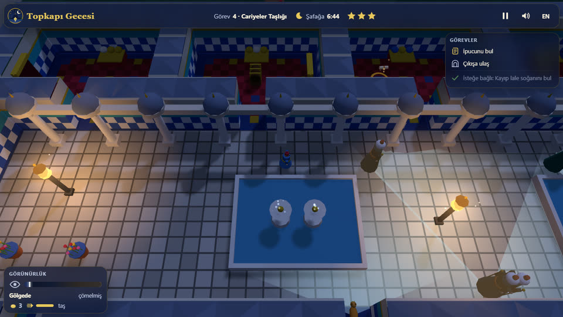
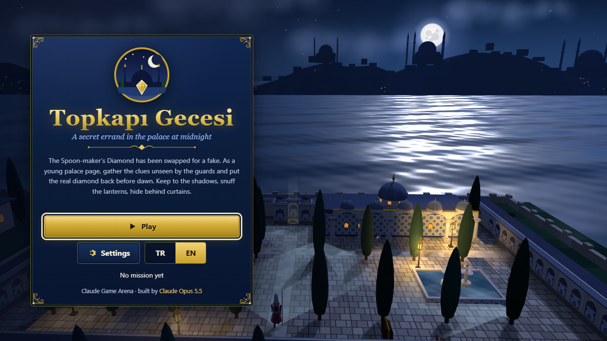
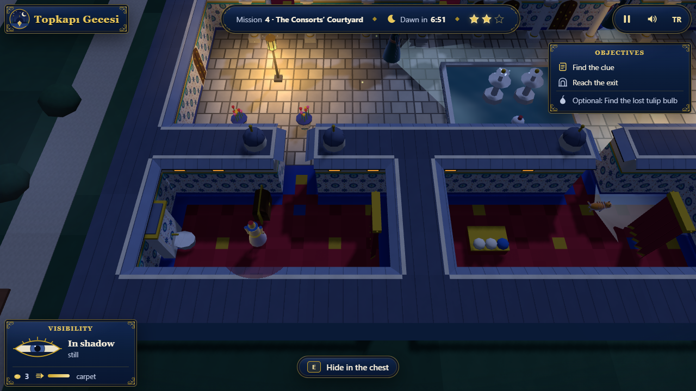
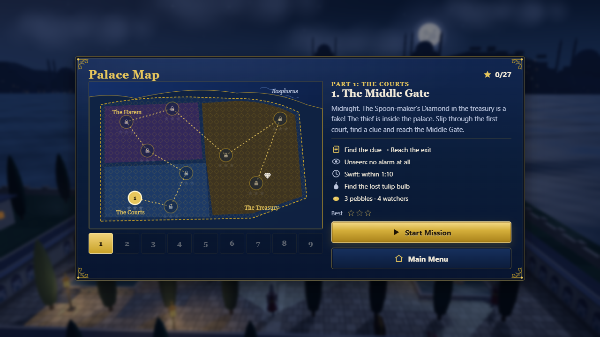
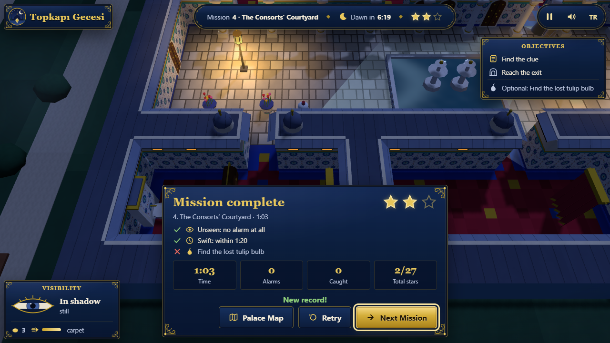
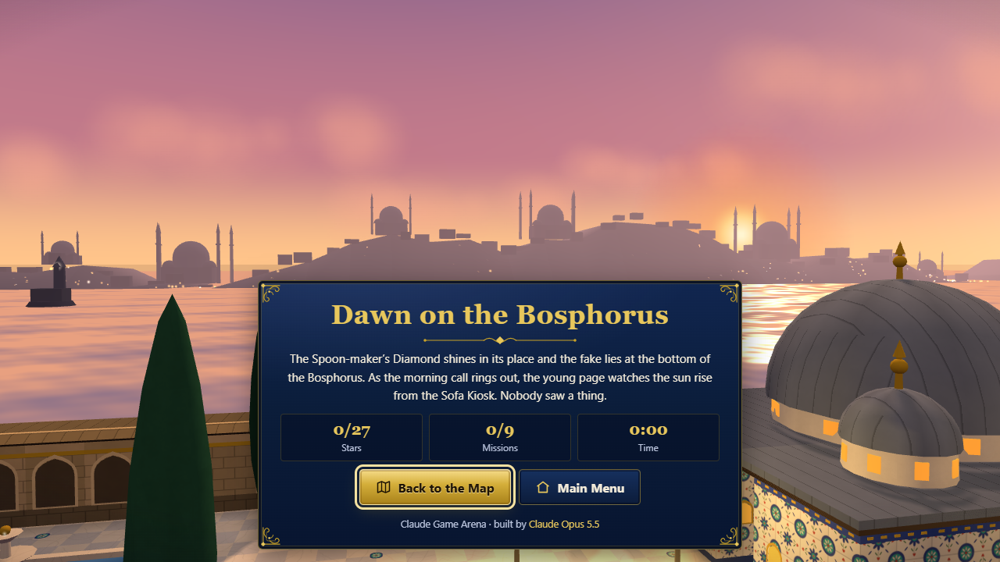
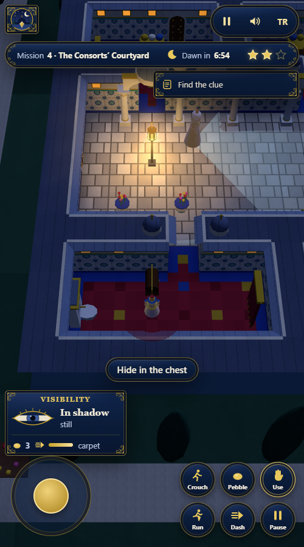
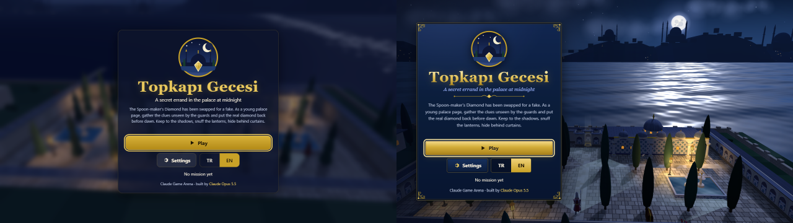
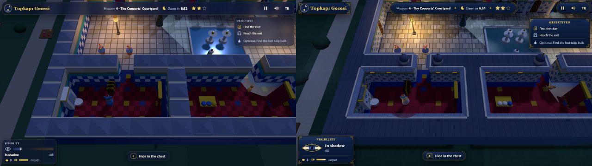

<p align="center">
  <a href="https://furkiozknn.github.io/topkapi-gecesi/">
    
  </a>
</p>

<p align="center">
  <a href="https://furkiozknn.github.io/topkapi-gecesi/"></a>
</p>

<p align="center">
  
  
  <a href="LICENSE"></a>
  
</p>

<!-- portals:start -->
<p align="center">
  Also on: <a href="https://furkiozknn.itch.io/topkapi-gecesi"><strong>itch.io</strong></a>
</p>
<!-- portals:end -->

<p align="center">
  <strong>A 3D stealth game at night in an Ottoman palace: the Spoon-maker's Diamond has been swapped for a fake, and you, a young palace page, sneak through the courts, the Harem and the Treasury to put the real one back before dawn without being caught.</strong>
</p>

<!-- gameplay gif -->

## Features

- **Nine night missions across three palace quarters:** Sneak through The Courts, The Harem, and The Treasury across 9 distinct missions, each featuring an optional objective (a lost tulip bulb, a secret letter, or "be a ghost") and 27 total stars to earn before dawn breaks after 7 minutes.
- **Dynamic vision cones & patrol AI:** Halberdiers, harem guards, the head cook and his cat patrol active routes; bright inner cones spot you even in shadow, while faint outer cones spot you in lantern light. Footstep gravel and noise rings alert guards from patrol to suspicious (`?`) to alarm (`!`), with pebble throws (up to 9 m) to lure them away.
- **Interactive light, shadow & hiding spots:** Moonlight casts long cypress shadows against warm lantern pools; snuff lanterns to extinguish light zones, hide behind curtains or inside chests, and monitor exposure with the animated almond-eye visibility meter.
- **Space-time A\* bot simulation:** An automated `?auto` bot plans timed escape routes avoiding every vision cone and noise ring using a space-time A* search—tested and verified across **9/9 missions, 27/27 stars, 0 alarms**, 60 fps, and 26–33 draw calls in play.
- **Ultra-lean zero-asset performance:** A single `index.html` running Three.js r170 delivering 60 fps at 26–33 draw calls in play (39–47 on title, 78k–84k triangles) on Intel UHD 620, with 100% procedural meshes, textures, and makam Hicaz Web Audio.

## How to play

> [!TIP]
> **Goal:** Pick up the clue (a scroll, the real diamond, the treasury key), then reach the gold ring at the exit (or place the diamond on the pedestal in the final mission) before dawn after 7 minutes. Being caught sends you back to the last quiet fountain checkpoint.

1. **Stay in the shadows:** Crouch (`C` or hold `Ctrl`) to lower your visibility and quiet your steps. Watch guard vision cones: the bright inner cone spots you anywhere; the faint outer cone spots you only in lantern light.
2. **Distract and manipulate:** Throw a pebble (`Q`, up to 9 m) behind a guard to pull him off his route. Snuff lanterns (`E`) to plunge hallways into darkness, or hide inside chests and behind curtains (`E`).
3. **Ghost to the exit:** Time your dashes (`Space`), collect the mission clue, fulfill the optional objective (bulb, letter, or ghost), and reach the gold exit ring unseen.

<details>
<summary><b>The nine missions</b></summary>

| Part | Mission | Optional objective | Target time |
|---|---|---|---|
| The Courts | 1. The Middle Gate | lost tulip bulb | 1:10 |
| The Courts | 2. The Palace Kitchens | secret letter | 2:10 |
| The Courts | 3. The Divan Square | be a ghost | 1:10 |
| The Harem | 4. The Consorts' Courtyard | lost tulip bulb | 1:20 |
| The Harem | 5. The Golden Road | be a ghost | 2:00 |
| The Harem | 6. The Imperial Hall | secret letter | 1:30 |
| The Treasury | 7. The Enderun Court | lost tulip bulb | 1:15 |
| The Treasury | 8. The Baghdad Kiosk | be a ghost | 1:35 |
| The Treasury | 9. The Treasury | secret letter | 2:30 |

**Stars:** unseen (no alarm), swift (within the target time) and the optional objective.

</details>

### Controls

| Action | Keyboard / mouse | Touch |
|---|---|---|
| Move | `WASD` or arrow keys | left stick |
| Run | hold `Shift` | Run button (hold) |
| Crouch | `C` toggles, hold `Ctrl` | Crouch button |
| Dash | `Space` | Dash button |
| Interact: hide, come out, snuff, pick up, place | `E` | Use button |
| Throw a pebble | `Q` (lands at the mouse ring, at most 9 m) | Pebble button (throws ahead) |
| Orbit the camera / zoom | drag / mouse wheel | drag / pinch |
| Pause | `P` or `Esc` | Pause button |
| Music / effects / language | `M` / `X` / `L` | top bar buttons |

- **Global hotkeys:** `P` / `Esc` pause, `M` music, `X` effects, `L` language (Turkish / English).
- **Audio & touch:** Dedicated top bar controls mute music and sound effects; touch offers a responsive left virtual stick and action buttons.
- **Persistence:** Settings are saved in `localStorage` under `arena.topkapi.settings`, progress under `arena.topkapi.save`, and the best results under `arena.topkapi.best`. Turkish is default, English with `L`.

<details>
<summary><b>URL flags for testing</b></summary>

| Flag | Effect |
|---|---|
| `?auto` | the bot plays all nine missions and the ending |
| `?debug` | fps, draw calls, triangles, GPU and JS errors on screen; `window.topkapiSim(seconds)` fast-forwards without rendering |
| `?sim=N` | fast-forward N seconds before the first frame |
| `?low` | Low quality: no shadows, half the particles, pixel ratio 1 |
| `?mission=N` | start mission N directly |
| `?screen=map` / `?screen=end` | open the palace map or the ending screen |
| `?speed=N` | game speed multiplier during missions |
| `?lang=en` / `?lang=tr` | language |
| `?nosave` | do not read or write progress |
| `?noassets` | accepted; the game has no asset files, so nothing changes |

The live state is on `window.topkapi` (screen, mission, player, guards, stars, bot log, fps, draw calls, errors, assets).

</details>

## Screenshots

<table>
  <tr>
    <td width="33%"><br><sub>Title screen</sub></td>
    <td width="33%"><br><sub>The Consorts' Courtyard</sub></td>
    <td width="33%"><br><sub>Palace map and briefing</sub></td>
  </tr>
  <tr>
    <td><br><sub>Mission result</sub></td>
    <td><br><sub>Ending: dawn over the Bosphorus</sub></td>
    <td><br><sub>On a phone</sub></td>
  </tr>
</table>

## Redesign & Performance

**Art direction:** Moonlit noir stealth. Night blue `#0B1D3A`, moonlight `#9DB4FF`, warm lantern pool `#FFB547`, imperial gold `#C9A227`, and Iznik white and cobalt blue; cold moonlight against warm lantern pools, with dark lacquer UI and gold filigree.

**Visual updates (rules, guards, missions, stars, bot, and saves are untouched):**
- **World:** Night sky with a low moon and clouds over a shader Bosphorus with a moon path; world-space stone, Iznik tile, marble, carpet, lead and ashlar textures; blind arcades with tile panels, carved doors, eaves, colonnades with bay domes, lantern light shafts and warm pools, contact shadows and lathe cypresses.
- **Characters:** Guards, the page and the cat rebuilt from lathe kaftans with gold trim, caps, turban and fez, with a walk cycle in the vertex shader and a moonlit rim light so silhouettes read clearly in the dark.
- **FX & UI:** Mist outside the walls, pulsing alert icons, gravel and running dust, moths at the lanterns, star and window flicker. Lacquer cartouches for the top bar, SVG filigree corners, gold-leaf buttons, almond-eye visibility meter whose lids open with exposure, and gold-ink palace map. Phone portrait and landscape re-laid out so prompts and touch controls never overlap.

**Measured on an Intel UHD 620 (headless Chrome, 1280x720):**
- Frame rate: 60 &rarr; 60 fps
- Draw calls: 27–31 &rarr; 29–33 in play (39 &rarr; 47 on title)
- Triangles: 27k–39k &rarr; 78k–84k
- `?auto` bot finishes all **9/9 missions with 27/27 stars** and 0 JS errors, with and without `?noassets`.





## Running locally

Serve the folder over HTTP (ES modules do not load from `file://`):

```bash
python -m http.server 8000
```

Then open <http://localhost:8000/>.

## Made with Claude Code

Built by **Claude Opus 5.5** with Claude Code from one prompt: [prompts/topkapi-gecesi.md](prompts/topkapi-gecesi.md). Everything is generated in code, so there are no asset files and no credits to list; Three.js is loaded from a CDN under its MIT licence.

<details>
<summary><b>Technical notes</b></summary>

- **Simulation core:** The rules (grid, light, sight, noise, guard states, player and the planner bot) live in one plain `CORE` script with no DOM or Three.js, so the same code runs in the page and in node tests.
- **Bot:** It predicts guard patrols and plans a timed route with a space-time A* search over (cell, 0.2 s) that keeps out of every cone and noise ring, hides behind curtains when that is the only safe spot, and replans whenever a guard leaves its route.
- **3D & lighting:** The level is merged into a few static meshes with vertex colours; lantern light is baked into a vertex attribute and rebaked only when a lantern is snuffed or relit. One moon light with a 1024 shadow map covers only the palace grounds.
- **Audio (Web Audio only):** Synthesised ney melody over a kanun ostinato in makam Hicaz, ambient crickets, running fountain, and surface-dependent footsteps (stone, gravel, marble, carpet) with dynamic tempo and darbuka on suspicion.
- **Performance:** Measured in headless Chrome on an Intel UHD 620 (i5-10210U) at 1280x720: 60 fps, 26–33 draw calls and 68k–84k triangles during play.

</details>

### Claude Game Arena

Topkapı Gecesi is part of the **Claude Game Arena** series, where each game is built by a Claude model from one prompt.

[Hisar](https://furkiozknn.github.io/kale-savunmasi/) · [Çay Ocağı](https://furkiozknn.github.io/cay-ocagi/) · [Çini Ustası](https://furkiozknn.github.io/cini-ustasi/) · [Martı](https://furkiozknn.github.io/marti/) · [Kervan](https://furkiozknn.github.io/kervan/) · [Dolmuş](https://furkiozknn.github.io/dolmus/) · [Peri Golf](https://furkiozknn.github.io/peri-golf/) · [Mehter](https://furkiozknn.github.io/mehter/) · [Boğaz Vapuru](https://furkiozknn.github.io/bogaz-vapuru/) · [Simit Fırını](https://furkiozknn.github.io/simit-firini/) · [Karagöz](https://furkiozknn.github.io/karagoz/) · [Lale Bahçesi](https://furkiozknn.github.io/lale-bahcesi/)

**Round 5:** [Kapadokya Balonu](https://furkiozknn.github.io/kapadokya-balonu/) · [Ebru](https://furkiozknn.github.io/ebru/) · [Kırkpınar](https://furkiozknn.github.io/kirkpinar/) · [Çarşı Kaçışı](https://furkiozknn.github.io/carsi-kacisi/)

**Round 6:** **Topkapı Gecesi** · [Hamsi](https://furkiozknn.github.io/hamsi/) · [Pamukkale](https://furkiozknn.github.io/pamukkale/) · [Mimar Sinan](https://furkiozknn.github.io/mimar-sinan/)

## License

MIT, see [LICENSE](LICENSE).

Like the game? You can support new rounds on [Buy Me a Coffee](https://buymeacoffee.com/furkiozkann). The game stays free.
