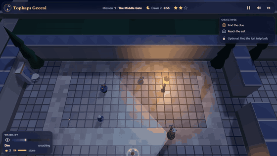
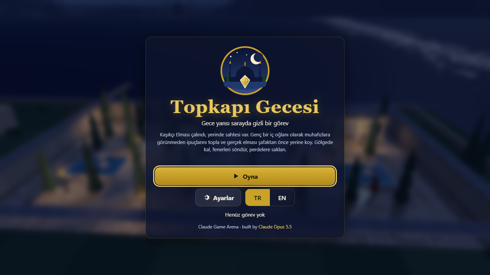
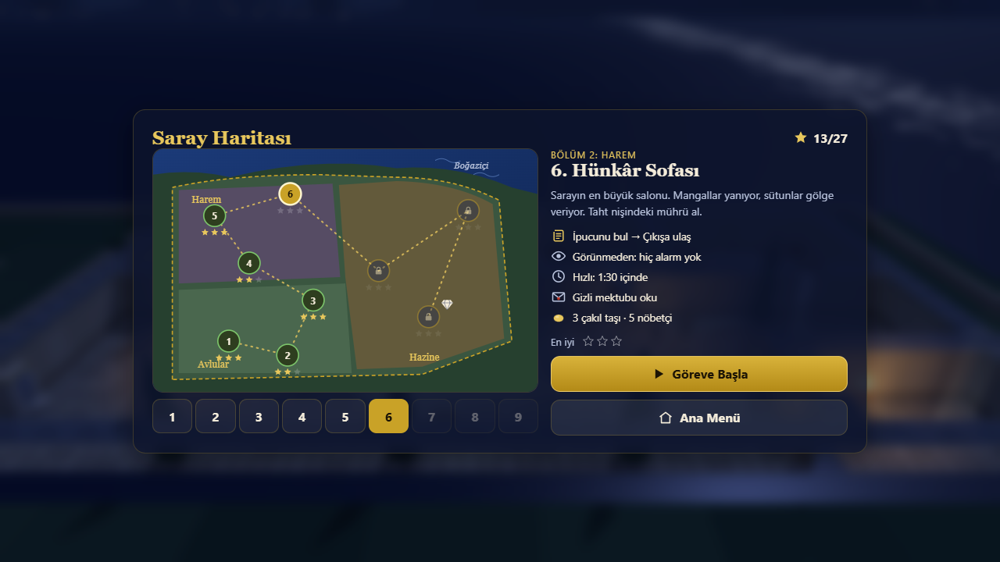
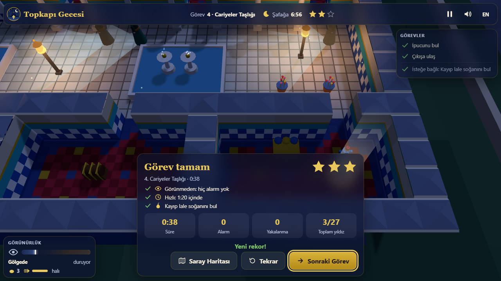
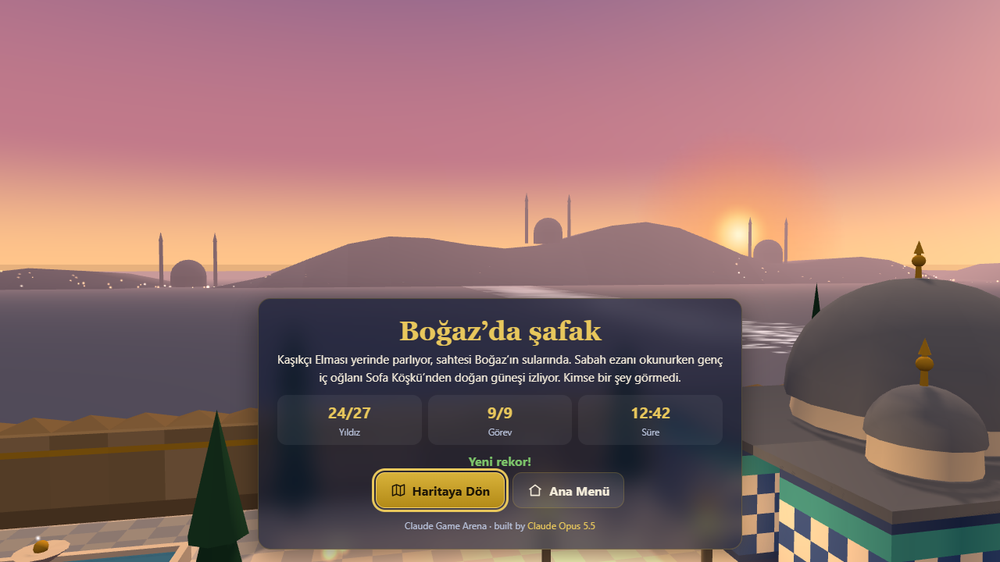
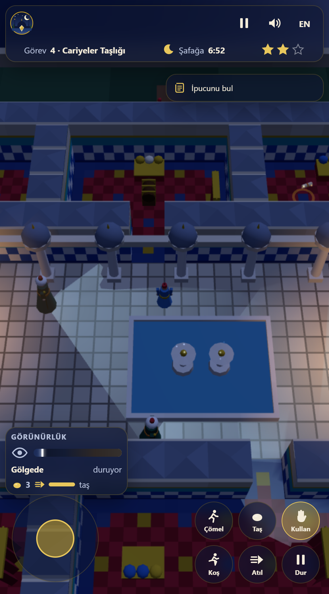

<p align="center">
  <a href="https://furkiozknn.github.io/topkapi-gecesi/"></a>
</p>

<p align="center">
  <a href="https://furkiozknn.github.io/topkapi-gecesi/"></a>
  
  
  <a href="LICENSE"></a>
  
</p>

<p align="center"><b>A 3D stealth game at night in an Ottoman palace: the Spoon-maker's Diamond has been swapped for a fake, and you, a young palace page, sneak through the courts, the Harem and the Treasury to put the real one back before dawn without being caught.</b></p>

<p align="center">
  
</p>

<p align="center"><b>Play online: <a href="https://furkiozknn.github.io/topkapi-gecesi/">https://furkiozknn.github.io/topkapi-gecesi/</a></b> (desktop and phone, no install)</p>

## Highlights

- **Real stealth rules.** Halberdiers, harem guards, the head cook and his cat walk patrol routes, stop and look
  around, and their vision cones are drawn on the ground. The bright inner part of a cone sees you even in shadow; the
  faint outer part sees you only when you stand in lantern light.
- **Light and shadow matter.** Walls and cypresses cast moon shadows, lanterns and braziers make warm pools of light,
  and the visibility meter shows how far a guard could see you right now. Snuff a lantern and its pool goes dark; a
  guard who passes it later lights it again.
- **Noise and guard states.** Running, gravel, a dash or a knocked-over vase sends out a sound ring. Guards go from
  patrol to suspicious (`?`, they walk over to look) to alarm (`!`, they chase and call the guards nearby), then search
  and return to the route. A thrown pebble lures them away. The cat cannot catch you, but it meows.
- **9 night missions in 3 parts.** The Courts, the Harem and the Treasury. Each mission has an optional objective (a
  lost tulip bulb, a secret letter or "be a ghost") and three stars: unseen, swift and the optional objective, 27 in all.
- **A bot that really plays.** `?auto` plays all nine missions with the same inputs a player has: it predicts the
  patrols and plans a timed route with a space-time A* search that keeps out of every cone and noise ring.
  Measured: **9/9 missions, 27/27 stars, 0 alarms**, 60 fps, 26-33 draw calls.
- **Night music that reacts.** A synthesised ney line over a kanun ostinato in makam Hicaz, crickets, a fountain and
  footsteps on stone, gravel, marble and carpet. When a guard grows suspicious the kanun speeds up and a darbuka joins.
- **One file, made in code.** One `index.html` with Three.js r170 from a CDN; every mesh, texture and sound is
  generated in code. Turkish by default, English with one key.

## How to play

> [!TIP]
> Crouch (`C`) in the shadows and watch the cones. Wait until a guard turns away, then move. A pebble (`Q`) thrown
> behind a guard pulls him off his route for a few seconds.

Each mission: pick up the clue (a scroll, the real diamond, the treasury key), then reach the gold ring at the exit (or
set the diamond on the pedestal in the last mission). Dawn comes after seven minutes. Hide behind curtains or in
chests, snuff lanterns and throw pebbles; being caught sends you back to the last quiet fountain (checkpoint).

<details>
<summary><b>The nine missions</b></summary>

| Part | Mission | Optional objective | Target time |
|---|---|---|---|
| The Courts | 1. The Middle Gate | lost tulip bulb | 1:10 |
| The Courts | 2. The Palace Kitchens | secret letter | 2:10 |
| The Courts | 3. The Divan Square | be a ghost | 1:10 |
| The Harem | 4. The Consorts' Courtyard | lost tulip bulb | 1:20 |
| The Harem | 5. The Golden Road | be a ghost | 2:00 |
| The Harem | 6. The Imperial Hall | secret letter | 1:30 |
| The Treasury | 7. The Enderun Court | lost tulip bulb | 1:15 |
| The Treasury | 8. The Baghdad Kiosk | be a ghost | 1:35 |
| The Treasury | 9. The Treasury | secret letter | 2:30 |

**Stars:** unseen (no alarm), swift (within the target time) and the optional objective.

</details>

### Controls

| Action | Keyboard / mouse | Touch |
|---|---|---|
| Move | `WASD` or arrow keys | left stick |
| Run | hold `Shift` | Run button (hold) |
| Crouch | `C` toggles, hold `Ctrl` | Crouch button |
| Dash | `Space` | Dash button |
| Interact: hide, come out, snuff, pick up, place | `E` | Use button |
| Throw a pebble | `Q` (lands at the mouse ring, at most 9 m) | Pebble button (throws ahead) |
| Orbit the camera / zoom | drag / mouse wheel | drag / pinch |
| Pause | `P` or `Esc` | Pause button |
| Music / effects / language | `M` / `X` / `L` | top bar buttons |

Settings are saved in `localStorage` under `arena.topkapi.settings`, progress under `arena.topkapi.save` and the best
result under `arena.topkapi.best`.

<details>
<summary><b>URL flags for testing</b></summary>

| Flag | Effect |
|---|---|
| `?auto` | the bot plays all nine missions and the ending |
| `?debug` | fps, draw calls, triangles, GPU and JS errors on screen; `window.topkapiSim(seconds)` fast-forwards without rendering |
| `?sim=N` | fast-forward N seconds before the first frame |
| `?low` | Low quality: no shadows, half the particles, pixel ratio 1 |
| `?mission=N` | start mission N directly |
| `?screen=map` / `?screen=end` | open the palace map or the ending screen |
| `?speed=N` | game speed multiplier during missions |
| `?lang=en` / `?lang=tr` | language |
| `?nosave` | do not read or write progress |
| `?noassets` | accepted; the game has no asset files, so nothing changes |

The live state is on `window.topkapi` (screen, mission, player, guards, stars, bot log, fps, draw calls, errors,
assets).

</details>

## Screenshots

<table>
  <tr>
    <td width="33%"><br><sub>Title screen</sub></td>
    <td width="33%"><br><sub>The Consorts' Courtyard</sub></td>
    <td width="33%"><br><sub>Palace map and briefing</sub></td>
  </tr>
  <tr>
    <td><br><sub>Mission result</sub></td>
    <td><br><sub>Ending: dawn over the Bosphorus</sub></td>
    <td><br><sub>On a phone</sub></td>
  </tr>
</table>

## Running locally

Serve the folder over HTTP, for example:

```
python -m http.server 8000
```

then open <http://localhost:8000/>.

## How it was made

Built by **Claude Opus 5.5** with Claude Code from one prompt: [prompts/topkapi-gecesi.md](prompts/topkapi-gecesi.md).
Everything is generated in code, so there are no asset files and no credits to list.

<details>
<summary><b>Technical notes</b></summary>

- **Simulation core:** the rules (grid, light, sight, noise, guard states, player and the planner bot) live in one plain
  `CORE` script with no DOM or Three.js, so the same code runs in the page and in node tests.
- **Bot:** it predicts the guard patrols and plans a timed route with a space-time A* search over (cell, 0.2 s) that
  keeps out of every cone and noise ring, hides behind a curtain when that is the only safe spot, and replans whenever
  a guard leaves its route.
- **3D:** the level is merged into a few static meshes with vertex colours; lantern light is baked into a vertex
  attribute and rebaked only when a lantern is snuffed or relit. One moon light with a 1024 shadow map covers only the
  palace grounds.
- **Performance:** measured in headless Chrome on an Intel UHD 620 (i5-10210U) at 1280x720: 60 fps, 26-33 draw calls
  and 16k-28k triangles during play.

</details>

Topkapı Gecesi is part of the **Claude Game Arena** series, where each game is built by a Claude model from one
prompt. The other games: [Hisar](https://furkiozknn.github.io/kale-savunmasi/) ·
[Çay Ocağı](https://furkiozknn.github.io/cay-ocagi/) · [Çini Ustası](https://furkiozknn.github.io/cini-ustasi/) ·
[Martı](https://furkiozknn.github.io/marti/) · [Kervan](https://furkiozknn.github.io/kervan/) ·
[Dolmuş](https://furkiozknn.github.io/dolmus/) · [Peri Golf](https://furkiozknn.github.io/peri-golf/) ·
[Mehter](https://furkiozknn.github.io/mehter/) · [Boğaz Vapuru](https://furkiozknn.github.io/bogaz-vapuru/) ·
[Simit Fırını](https://furkiozknn.github.io/simit-firini/) · [Karagöz](https://furkiozknn.github.io/karagoz/) ·
[Lale Bahçesi](https://furkiozknn.github.io/lale-bahcesi/)

**Round 5:** [Kapadokya Balonu](https://furkiozknn.github.io/kapadokya-balonu/) ·
[Ebru](https://furkiozknn.github.io/ebru/) · [Kırkpınar](https://furkiozknn.github.io/kirkpinar/) ·
[Çarşı Kaçışı](https://furkiozknn.github.io/carsi-kacisi/)

**Round 6:** **Topkapı Gecesi** · [Hamsi](https://furkiozknn.github.io/hamsi/) ·
[Pamukkale](https://furkiozknn.github.io/pamukkale/) · [Mimar Sinan](https://furkiozknn.github.io/mimar-sinan/)

## Türkçe

**Topkapı Gecesi**, gece bir Osmanlı sarayında geçen 3D gizlilik oyunu. Kaşıkçı Elması sahtesiyle değiştirilmiş; genç
bir iç oğlanı olarak avlulardan, Harem'den ve Hazine'den gizlice geçip ipuçlarını bulur, gerçek elması şafaktan önce
yerine koyarsın. Muhafızların görüş konileri, fener ışığı ve gürültü önemli: gölgede çömel, fenerleri söndür, çakıl
taşı atıp muhafızları uzaklaştır. 3 bölümde 9 gece görevi, 27 yıldız. Kurulum yok; masaüstünde ve telefonda tarayıcıda
oynanır. Claude Opus 5.5 tarafından Claude Code ile tek bir prompt'tan yapıldı.

**Oyna:** https://furkiozknn.github.io/topkapi-gecesi/

## License

MIT, see [LICENSE](LICENSE).
