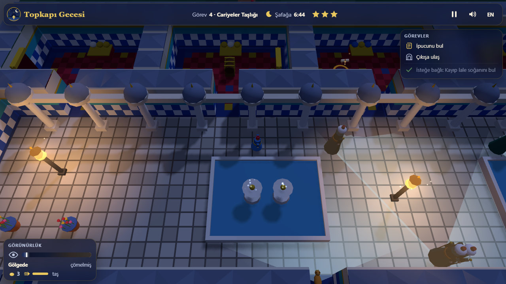

# Topkapı Gecesi

  

**A 3D stealth game at night in an Ottoman palace.** The Spoon-maker's Diamond (Kaşıkçı Elması) has been swapped
for a fake by a thief inside the palace. You are a young palace page (iç oğlanı): sneak through the courts, the Harem
and the Treasury, find the clues and put the real diamond back on its pedestal before dawn, without being caught.

One `index.html`, Three.js r170 from a CDN, every mesh, texture and sound generated in code. Turkish by default,
English with one key.

## Highlights

- **Real stealth rules.** Guards (halberdiers, harem guards, the head cook and his cat) walk patrol routes, stop and
  look around, and their vision cones are drawn on the ground. The bright inner part of a cone sees you even in
  shadow; the faint outer part sees you only when you stand in lantern light.
- **Light and shadow matter.** Walls and cypresses cast moon shadows, lanterns and braziers make warm pools of light.
  The visibility meter shows how far a guard could see you right now. Snuff a lantern and its pool goes dark (the
  light is baked into the walls and floor and rebaked); a guard who passes it later lights it again.
- **Noise.** Running, walking on gravel, dashing or knocking over a vase sends out a sound ring. Guards inside the ring
  turn, walk over to look and search. A thrown pebble does the same where it lands, so you can lure them away.
- **Guard states.** Patrol → suspicious (a `?`, turns, walks to what it saw or heard, looks around) → alarm (a `!`,
  chases at a run and calls the guards nearby) → search → back to the route. The cat cannot catch you, but it meows.
- **Your tools.** Crouch-walk, run, a short dash, hide behind curtains or in chests, snuff lanterns, throw pebbles.
  Caught means back to the last quiet fountain (checkpoint).
- **9 night missions in 3 parts** (the Courts, the Harem, the Treasury), all in one mission table. Each has an
  optional objective: a lost tulip bulb, a secret letter, or "be a ghost" (nobody even grows suspicious).
  Three stars each: unseen (no alarm), swift (target time) and the optional objective. 27 stars in all.
- **A bot that really plays.** `?auto` plays all nine missions with the same inputs a player has. It predicts the guard
  patrols and plans a timed route with a space-time A* search over (cell, 0.2 s) that keeps out of every cone and
  noise ring, hides behind a curtain when that is the only safe spot, and replans whenever a guard leaves its route.
  Measured: **9/9 missions, 27/27 stars, 0 alarms, 0 times caught**.
- **Night music that reacts.** A synthesised ney line over a kanun ostinato in makam Hicaz, a soft drone, crickets,
  fountain trickle, footsteps on stone, gravel, marble and carpet, guard murmurs as blips. When a guard grows
  suspicious the kanun speeds up and a darbuka joins.

## How to play

> [!TIP]
> Crouch (`C`) in the shadows and watch the cones. Wait until a guard turns away, then move. A pebble (`Q`) thrown
> behind a guard pulls him off his route for a few seconds.

Each mission: pick up the clue (a scroll, the real diamond, the treasury key), then reach the gold ring at the exit
(or set the diamond on the pedestal in the last mission). Dawn comes after seven minutes.

### Controls

| Action | Keyboard / mouse | Touch |
|---|---|---|
| Move | `WASD` or arrow keys | left stick |
| Run | hold `Shift` | Run button (hold) |
| Crouch | `C` toggles, hold `Ctrl` | Crouch button |
| Dash | `Space` | Dash button |
| Interact: hide, come out, snuff, pick up, place | `E` | Use button |
| Throw a pebble | `Q` (lands at the mouse ring, at most 9 m) | Pebble button (throws ahead) |
| Orbit the camera / zoom | drag / mouse wheel | drag / pinch |
| Pause | `P` or `Esc` | Pause button |
| Music / effects / language | `M` / `X` / `L` | top bar buttons |

### Missions

| Part | Mission | Optional objective | Target time |
|---|---|---|---|
| The Courts | 1. The Middle Gate | lost tulip bulb | 1:10 |
| The Courts | 2. The Palace Kitchens | secret letter | 2:10 |
| The Courts | 3. The Divan Square | be a ghost | 1:10 |
| The Harem | 4. The Consorts' Courtyard | lost tulip bulb | 1:20 |
| The Harem | 5. The Golden Road | be a ghost | 2:00 |
| The Harem | 6. The Imperial Hall | secret letter | 1:30 |
| The Treasury | 7. The Enderun Court | lost tulip bulb | 1:15 |
| The Treasury | 8. The Baghdad Kiosk | be a ghost | 1:35 |
| The Treasury | 9. The Treasury | secret letter | 2:30 |

## URL flags

| Flag | Effect |
|---|---|
| `?auto` | the bot plays all nine missions and the ending |
| `?debug` | fps, draw calls, triangles, GPU and JS errors on screen; `window.topkapiSim(seconds)` fast-forwards without rendering |
| `?sim=N` | fast-forward N seconds before the first frame |
| `?lang=en` / `?lang=tr` | language |
| `?low` | Low quality: no shadows, half the particles, pixel ratio 1 |
| `?mission=N` | start mission N directly |
| `?nosave` | do not read or write progress |
| `?noassets` | accepted for the arena test suite; the game has no asset files, so nothing changes |

The live state is on `window.topkapi` (screen, mission, player, guards, stars, bot log, fps, draw calls, errors,
assets). Settings are stored in `localStorage` under `arena.topkapi.settings`, progress under `arena.topkapi.save`
and the best result under `arena.topkapi.best`.

## Performance

Measured in headless Chrome on an Intel UHD 620 (i5-10210U) at 1280x720: 60 fps, 26-33 draw calls and
16k-28k triangles during play. The level is merged into a few static meshes with vertex colours; lantern light is
baked into a vertex attribute and rebaked only when a lantern is snuffed or relit. One moon light with a 1024 shadow
map covering only the palace grounds.

## How it was made

Built by Claude Opus 5.5 with Claude Code from one prompt: [prompts/topkapi-gecesi.md](prompts/topkapi-gecesi.md).
The rules (grid, light, sight, noise, guard states, player, planner bot) live in one plain `CORE` script with no
DOM or Three.js, so the same code runs in the page and in node tests. No external assets: models, textures, music
and sound effects are all generated in code.

## Licence

[MIT](LICENSE). Claude Game Arena · built by Claude Opus 5.5.
